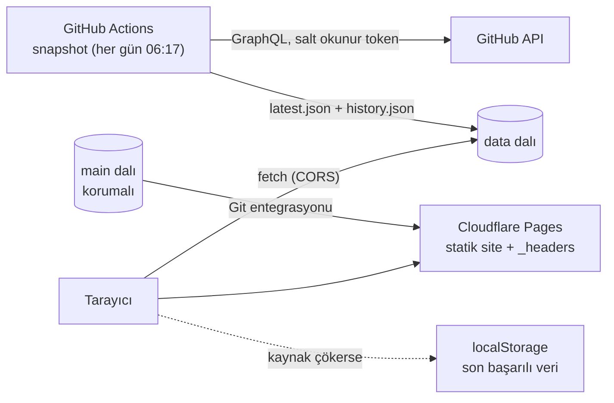

# Türkiye Açık Kaynak Radarı

Türkiye'den çıkan açık kaynak projeleri her gün takip eden, katkı verilecek proje arayan öğrenciler için hazırlanmış bir veri ürünü. GitHub verisinden kendi zaman serisini biriktirir, haftanın en hızlı büyüyen projelerini ve "good first issue" etiketli işleri gösterir. Her işlevi klavyeyle (Ctrl/Cmd + K) kullanılabilir.

- **Canlı ürün:** <https://acik-kaynak-radari.pages.dev>
- **Veri dalı:** [`data`](https://github.com/enesaltiparmak/acik-kaynak-radari/tree/data)
- **Ders:** MCBÜ Büyük Veri Analistliği. BVA 2245 Kullanıcı Arayüzü Tasarımı ve Bulut Bilişim ve Siber Güvenlik (aynı ürün, aynı depo).

> Kurgusal müşteri: MCBÜ'deki bir yazılım öğrenci topluluğu. Ürün GitHub ile bağlantılı değildir; resmî bir araç değildir.

## CV cümleleri

- **Arayüz:** GitHub API verisini GitHub Actions ile her gün çekip kendi zaman serisini biriktiren, 500 Türk açık kaynak projesinin haftalık büyümesini ve "good first issue" fırsatlarını gösteren klavye öncelikli bir pano geliştirdim (Chart.js, Vite; Lighthouse erişilebilirlik `__`).
- **Güvenlik:** Canlı veri ürünümün CI/CD hattını sertleştirdim: en az yetkili workflow'lar, SHA ile sabitlenmiş Actions, harden-runner ile egress engelleme ve branch protection sayesinde OpenSSF Scorecard puanını `__`'dan `__`'a çıkardım.

## Mimari



1. `snapshot` workflow'u her gün GitHub GraphQL API'den konumu Türkiye veya bir Türkiye şehri olan hesap ve kuruluşların en popüler depolarını çeker (ilk 500, 30+ yıldız, arşivlenmemiş, fork değil).
2. Her çalıştırma `data` dalındaki `history.json`'a o günün ölçümünü ekler. GitHub geçmiş yıldız sayısı vermediği için zaman serisi bu snapshot'lardan birikir.
3. Site, veriyi `raw.githubusercontent.com` üzerinden okur. Kod deposu (main) korumalı kalırken bot yalnızca `data` dalına yazar.
4. Kaynak çalışmazsa sırasıyla tarayıcıdaki son başarılı veri ve siteyle birlikte yayımlanan kopya kullanılır. Kullanıcıya her durumda hangi verinin gösterildiği söylenir.

## Özellikler

- 4 KPI kartı, en hızlı büyüyenler çubuk grafiği, seçili projenin yıldız zaman serisi, sıralanabilir proje tablosu
- Filtreler: arama, dil, dönem (7/30 gün), en az yıldız, yalnız good first issue
- **Komut paleti (Ctrl/Cmd + K):** filtre, sıralama, tema, proje arama, demo durumları
- Kısayollar: `/` arama, `G` good first issue, `T` tema, `?` yardım
- Yükleniyor (iskelet), boş sonuç ve hata durumları; çevrimdışı çalışma (PWA)
- Her grafikte otomatik özet cümlesi ve "veriyi tablo olarak gör"
- Renk tek başına anlam taşımaz: artış ve azalış ▲/▼ işareti ve +/− ile de gösterilir

### Demo durumları

| Adres | Durum |
| --- | --- |
| `?durum=yavas` | Kaynak 4 sn gecikir, iskelet görünür |
| `?durum=hata` | Canlı kaynak çöker, son başarılı veriyle açılır |
| `?durum=cokus` | Hiçbir kaynak yok, hata ekranı |
| `?durum=bos` | Veri boş gelir, boş durum ekranı |

## Kurulum

```bash
npm ci
npm run dev          # http://localhost:5173
npm test             # birim testleri
npm run build        # dist/
```

Yerelde veri çekmek için `.env.example` dosyasını `.env` olarak kopyalayıp salt okunur bir fine-grained token girin, sonra:

```bash
node --env-file=.env scripts/snapshot.mjs --out public/data
```

## Veri kaynağı ve lisans

> **Bilinen sınır:** GitHub geçmiş yıldız sayısını vermiyor; yıldız verenlerin tarih listesi de API'de artık erişilebilir değil (GraphQL boş liste, REST 404 döndürüyor). GH Archive denendi ancak günlük olay sayısı eksik olduğu için kullanılmadı. Bu yüzden zaman serisi ilk snapshot gününden (29 Ekim 2026) başlar. "Son 7 gün" verisi birikene kadar arayüz artışın kaç günü kapsadığını açıkça yazar.

- **Kaynak:** [GitHub GraphQL API](https://docs.github.com/graphql). Kullanım [GitHub Hizmet Şartları](https://docs.github.com/site-policy/github-terms/github-terms-of-service) ve hız sınırlarına tabidir; günde bir çekim yapılır.
- **Gizlilik:** Kullanıcı profili, konum, takipçi veya e-posta yayımlanmaz. Konum yalnızca aramada kullanılır ve kaydedilmez. Yalnızca herkese açık depo bilgisi (ad, açıklama, dil, sayaçlar) gösterilir.
- **Kod lisansı:** MIT.

## Güvenlik

Ayrıntılar: [SECURITY.md](SECURITY.md), [tehdit modeli](docs/THREAT-MODEL.md), [olay müdahale runbook'u](docs/RUNBOOK.md), [Scorecard ölçümü](docs/SCORECARD.md).

## Yapay zekâ kullanım beyanı

Bu projede **Claude Code (Anthropic)** kullanıldı:

- **Ne için:** proje iskeleti, veri çekme betiği, arayüz kodu, workflow dosyaları ve belge taslakları.
- **Nasıl değiştirdim:** `__` (burayı kendi değişikliklerinizle doldurun: ör. tasarım kararları, metinler, test sonrası düzeltmeler).
- **Kontrol:** Kodun her bölümünü okuyup demoda açıklayabileceğim şekilde inceledim; veri çekimini ve arayüzü kendim test ettim.
